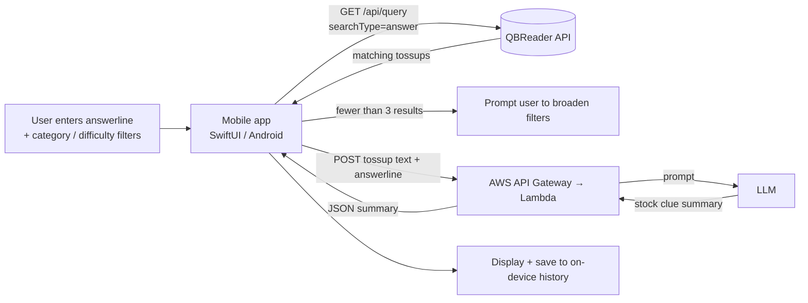

  

<h1 align="center">QbClues</h1>

  
  

---

## What it does

Type an answerline (e.g. *"Mitochondria"* or *"The Brothers Karamazov"*), optionally filter by
category and difficulty, and QbClues pulls real tossups from the QBReader database and distills
them into the **stock clues**: the facts that show up again and again across packets.

- Search any answerline across thousands of real tossups
- Filter by 12 categories and 11 difficulty levels (Middle School → Open)
- AI-generated summary of the most frequently asked clues
- Search history saved on-device
- Native apps for iOS (SwiftUI) and Android

## Screenshots

| iOS | Android |
|-----|---------|
|  |  |

## How the pipeline works

1. **Query.** The app sends the answerline to QBReader's `/api/query` endpoint, searching by
   *answer*, with the selected categories and difficulties as filters.
2. **Gate.** If fewer than 3 tossups match, the app skips the AI step and asks the user to broaden
   their filters, since too little data gives unreliable stock clues.
3. **Summarize.** The sanitized tossup text is sent to an AWS Lambda function behind API Gateway,
   which prompts an LLM to pull out the clues that repeat across questions.
4. **Display & save.** The summary is shown and stored locally, so past searches can be
   revisited offline.

See [docs/architecture.md](docs/architecture.md) for request/response formats and more detail.

## Tech stack

| Layer | Tech |
|-------|------|
| iOS | Swift, SwiftUI, async/await, UserDefaults |
| Android | Kotlin |
| Question data | [QBReader](https://www.qbreader.org) API |
| Backend | AWS Lambda + API Gateway |
| AI | Gemini |
| Monetization | Google AdMob (banner + interstitial) |

## Credits

Question data comes from [QBReader](https://www.qbreader.org). QbClues is not affiliated with
QBReader or any quizbowl organization.

## Contact

Feedback or bug reports: open an issue or email *asavrg@gmail.com*.
