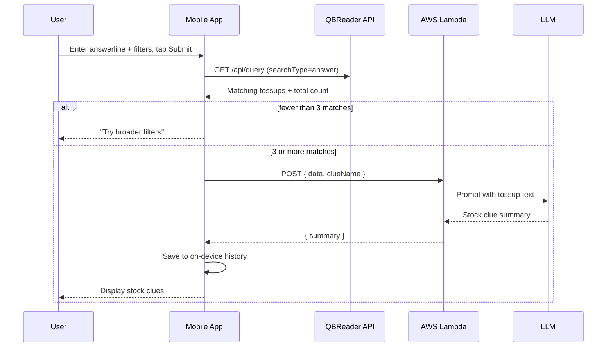

# QbClues Architecture

This document explains how QbClues turns a single answerline into a summary of stock clues: what each component does, how data moves between them, and how failures are handled.

## Overview

QbClues has three moving parts:

| Component | Role |
|-----------|------|
| **Mobile app** (iOS / Android) | Collects the query and filters, calls both services, displays and stores results |
| **QBReader API** | Public quizbowl question database; returns real tossups that match the answerline |
| **Summarization backend** (AWS API Gateway + Lambda) | Sends the tossup text to an LLM and returns the stock clues |

The app does the orchestration. QBReader and the backend never talk to each other directly.



## Step 1: User input

The user enters an **answerline** (the thing being studied, e.g. *"Mitochondria"*) and can narrow the search with two multi-select filters:

**Categories (12):** Literature, History, Science, Fine Arts, Religion, Mythology, Philosophy, Social Science, Current Events, Geography, Other Academic, Pop Culture

**Difficulties (11):**

| Level | Meaning |
|-------|---------|
| 0 | Pop Culture |
| 1 | Middle School |
| 2 | Easy High School |
| 3 | Regular High School |
| 4 | Hard High School |
| 5 | National High School |
| 6 | Easy College |
| 7 | Medium College |
| 8 | Regionals College |
| 9 | Nationals College |
| 10 | Open |

Leaving a filter empty means "all." The UI shows difficulties as labels such as `3: Regular High School`, but only the number is sent to QBReader.

An empty answerline is rejected before any network call.

## Step 2: Fetch questions from QBReader

The app sends a `GET` request to QBReader's query endpoint:

```
GET https://qbreader.org/api/query
    ?queryString=Mitochondria
    &searchType=answer
    &categories=Science
    &difficulties=3,4,5
```

| Parameter | Value |
|-----------|-------|
| `queryString` | The user's answerline |
| `searchType` | Always `answer`, so the search matches the *answerline*, not words in the question text |
| `categories` | Selected category names, comma-separated |
| `difficulties` | Selected difficulty numbers, comma-separated |

From the response, the app uses only two fields:

```json
{
  "tossups": {
    "count": 42,
    "questionArray": [
      { "question_sanitized": "This organelle's inner membrane is folded into cristae..." }
    ]
  }
}
```

- `count`: the total number of matching tossups
- `question_sanitized`: the plain-text tossup (formatting and pronunciation guides removed)

The tossup texts are joined into one newline-separated string for the next step.

## Step 3: Minimum-data gate

If QBReader reports **fewer than 3 matching tossups**, the app stops and asks the user to broaden their filters.

The point of a stock clue is that it repeats across questions. With one or two tossups, an LLM can only paraphrase those questions; it can't tell which clues are actually common. The gate also saves backend calls that wouldn't produce a useful answer.

## Step 4: Summarize with the backend

The app sends the tossup text to an AWS Lambda function behind API Gateway:

**Request:** `POST`, `Content-Type: application/json`

```json
{
  "data": "This organelle's inner membrane is folded into cristae...\nFor 10 points, name this...",
  "clueName": "Mitochondria"
}
```

**Response:**

```json
{
  "summary": "- Inner membrane folded into cristae\n- Site of the Krebs cycle\n- ..."
}
```

Inside the Lambda, the tossup text and answerline go into a prompt that asks the model to pull out the clues that come up most often across the questions.

*[Add details about your model and prompt here, e.g. which model you use, what the prompt asks for, and any output formatting rules.]*

**Why a backend instead of calling the LLM from the app?** The model's API key stays on the server and never ships inside the app, where anyone could extract it. Having one backend also means both the iOS and Android apps share the same prompt, and the prompt or model can change without an app-store update.

## Step 5: Display and history

The summary is shown on the main screen and saved as a history entry:

| Field | Description |
|-------|-------------|
| `id` | Unique ID |
| `clue` | The answerline searched |
| `category` | Categories selected |
| `difficulty` | Difficulty numbers selected |
| `result` | The returned summary |
| `date` | When the search was made |

History is stored **only on the device**: as JSON in `UserDefaults` on iOS *[Android: add storage method, e.g. SharedPreferences / DataStore / Room]*. No accounts, and no search history is sent to any server. Past results can be reopened from the history screen without another network call.

## Error handling

| Situation | What the user sees |
|-----------|--------------------|
| Empty answerline | "Please enter a clue" |
| Fewer than 3 matching tossups | "Unable to search, try to use broader filters" |
| Network, HTTP, or decoding error | "Something went wrong, try again" with the error details |

A loading indicator shows from Submit until a result or error comes back.

## Platform notes

| | iOS | Android |
|---|-----|---------|
| Language / UI | Swift, SwiftUI | Kotlin |
| Networking | `URLSession` with async/await  |
| Local storage | `UserDefaults` (JSON-encoded) |
| Ads | Google AdMob | Google AdMob |

## Monetization

The app is free and supported by Google AdMob:

- A **banner ad** at the bottom of the main screen
- An **interstitial ad** shown periodically during use (currently every 90 seconds on iOS)

On iOS, the app asks for App Tracking Transparency permission before ads are personalized. Declining still allows non-personalized ads.
